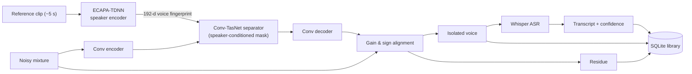

# EchoFocus

**Focus on the voice that matters.**

EchoFocus pulls one person's voice out of a messy recording. Give it a ~5-second clip of the speaker you care about and a recording where they talk over other people, music or room noise — it returns their voice on its own, everything else as a separate track, and a word-by-word transcript.

Built by **[@mittalkshitij2006-tech](https://github.com/mittalkshitij2006-tech)** and **[@rajatgitti](https://github.com/rajatgitti)** as our **AI553** course project.

---

## What it does

- **Target speaker extraction** — a speaker-conditioned Conv-TasNet separator isolates the enrolled voice from overlapping speech and noise.
- **Residue track** — everything that was removed (other speakers, background) is kept as its own track, so voice + residue reconstructs the input exactly.
- **Multilingual transcription** — Whisper transcribes the isolated voice in English, Hindi or Urdu (or auto-detects), with per-word timings and confidence.
- **Export** — download either track as WAV, the transcript as TXT or timecoded SRT.
- **Session library** — every run is saved to SQLite with its audio, so you can reload past results after a restart.
- **Interactive studio** — a WebGL particle interface (three.js) that reacts while the model works, with waveform players, a guided tour and a built-in sample.

## How it works



1. The speaker encoder turns the reference clip into a 192-dimensional voice fingerprint.
2. The separator predicts a mask over the encoded mixture, conditioned on that fingerprint at every layer.
3. The decoder turns the masked features back into audio; a least-squares step restores the correct gain and polarity so the residue is exactly *mixture − voice*.
4. Whisper transcribes the isolated voice; results and audio are stored in the library.

| Component | Details | Weights |
|---|---|---|
| Separator | Conv-TasNet, 24 dilated depthwise TCN blocks, 3.4 M params | `checkpoints/fully_ours/best.pt` (38 MB) |
| Speaker encoder | ECAPA-TDNN, 6.0 M params, frozen | `checkpoints/spk_encoder/best.pt` (76 MB) |
| ASR | OpenAI Whisper `small` on GPU (kept in memory), `tiny` on CPU (loaded on demand); override with `ECHOFOCUS_WHISPER_MODEL` | downloaded automatically |

## Results

Evaluated on 300 held-out mixtures (40 LibriSpeech dev-clean speakers the model never trained on; two speakers plus noise and reverb, 0–10 dB interference):

| Metric | Original weights | **Our fine-tune** |
|---|---|---|
| SI-SDR (mean / median) | 8.42 / 8.84 dB | **8.56 / 9.01 dB** |
| SI-SDR improvement over the input | +5.49 dB | **+5.64 dB** |
| PESQ (perceptual quality) | 1.39 | **1.45** |
| STOI (intelligibility) | 0.799 | **0.802** |

The fine-tune wins on 66% of individual mixtures (paired t = 2.72, p < 0.05). It was trained for 10 epochs on LibriSpeech train-clean-100 with on-the-fly mixing, recording-chain augmentation and turn-taking mixtures, warm-started from the original weights (~85 min on an RTX 4050 Laptop GPU). The original weights are kept as `checkpoints/fully_ours/best_original.pt`.

**Speed** (RTX 4050 Laptop GPU, full `/extract` request including clean-up, transcription and saving): an 8 s clip takes ~1.8 s and a 30 s clip ~4.8 s, with ~3.6 GB peak GPU memory. Models are warmed up at startup, so the first request is as fast as the rest. Switching transcription from Whisper `tiny` to `small` raised word confidence on the bundled sample from 0.65 to 0.89.

---

## Getting started

**Requirements:** Python 3.11–3.13, Node.js 20+, and Git (Git Bash on Windows). An NVIDIA GPU is optional but makes extraction several times faster.

```bash
git clone https://github.com/rajatgitti/EchoFocus.git
cd EchoFocus
bash run.sh
```

On Windows you can also just **double-click `run.bat`**.

The first run sets everything up — a Python virtualenv, PyTorch (CUDA build if a GPU is found), dependencies, the trained weights (~110 MB) and the frontend packages — then starts both servers. Later runs skip straight to launching. Open **http://localhost:3000** and press **Try a sample** to see it work.

Press `Ctrl+C` (or close the window) to stop. `bash run.sh --setup` installs without launching.

<details>
<summary>Manual setup</summary>

```bash
python -m venv .venv && source .venv/bin/activate   # Windows: .venv\Scripts\activate
pip install -r requirements.txt
python scripts/download_weights.py
python server.py --port 8000                        # terminal 1

cd web && npm install && npm run dev                # terminal 2
```

Whisper needs `ffmpeg` on your PATH (`run.sh` handles this automatically).
</details>

<details>
<summary>Training / fine-tuning</summary>

```bash
# datasets (use --mirror openslr.elda.org if openslr.org is slow)
python scripts/download_data.py --only librispeech,librispeech-train,rirs --mirror openslr.elda.org

# fixed validation set from held-out speakers
python scripts/build_dataset.py --n 300 --out datasets/vanta --split dev --source dev-clean \
    --seed 1234 --intf-snr 0 10 --augment --partial-overlap 0.5

# fine-tune the separator from the current weights
python scripts/train.py --dynamic --init-from checkpoints/fully_ours/best.pt \
    --speaker-encoder checkpoints/spk_encoder/best.pt --train-source train-clean-100 \
    --val-manifest datasets/vanta/dev/manifest.jsonl --out checkpoints/finetune \
    --intf-snr 0 10 --augment --partial-overlap 0.5 --clip-seconds 3.0 \
    --batch-size 2 --grad-accum 2 --lr 1e-4 --lr-min 1e-5 --epochs 10 --epoch-size 3000 --num-workers 4

# evaluate
python scripts/evaluate.py --checkpoint checkpoints/finetune/best.pt \
    --speaker-encoder checkpoints/spk_encoder/best.pt --manifest datasets/vanta/dev/manifest.jsonl
```
</details>

---

## API

The backend runs on port 8000.

| Endpoint | Purpose |
|---|---|
| `GET /health` | Model status, device and checkpoint paths |
| `POST /extract?include_residue=true` | Form fields `mixture`, `enrollment` (WAV/MP3/M4A/FLAC/MP4), optional `language` (`auto`/`en`/`hi`/`ur`). Returns both tracks as base64 WAV plus transcript, word timings and a `session_id` |
| `POST /transcribe` | Re-run ASR for a `session_id` (or an uploaded `audio` file) in a chosen `language` |
| `GET /library` | The 50 most recent sessions |
| `GET /library/<id>/audio/<track>` | `extracted`, `residue`, `mixture` or `reference` |
| `DELETE /library/<id>` | Delete a session and its audio |

<details>
<summary>Example <code>/extract</code> response</summary>

```json
{
  "extracted_wav_b64": "UklGRi...",
  "residue_wav_b64": "UklGRi...",
  "sample_rate": 16000,
  "input_seconds": 8.0,
  "output_seconds": 8.0,
  "truncated": false,
  "transcript": "Without any legal signs, without any royal mandate, ...",
  "confidence": 0.744,
  "detected_language": "en",
  "words": [{ "word": "Without", "start": 0.0, "end": 0.6, "probability": 0.70 }],
  "session_id": "a792f014-af6",
  "created_at": "2026-11-11T07:12:53+00:00"
}
```
</details>

> The API has no authentication — run it on `localhost` or behind your own auth, not on the open internet.

## Limitations

- **Reference length:** the speaker encoder uses exactly 5 s of reference audio — shorter clips are zero-padded, longer ones trimmed to the first 5 s. Use a clip where only the target is speaking.
- **Mixture length:** capped at 30 s on GPU and 20 s on CPU; longer files are truncated.
- **Hard cases:** trained on two-speaker mixtures where the target is at least as loud as the interferer. Quieter targets, 3+ simultaneous speakers or very heavy noise degrade quality, and some faint residual noise can remain in pauses.

---

## Acknowledgements

The separator architecture and original trained weights come from **[VANTA](https://github.com/Komalpreet2809/Vanta)** by Komalpreet Kaur (MIT). Training data: LibriSpeech and RIRS_NOISES from [OpenSLR](https://openslr.org). Full third-party notices are in [THIRD_PARTY_NOTICES.md](THIRD_PARTY_NOTICES.md).

## License

[MIT](LICENSE)
