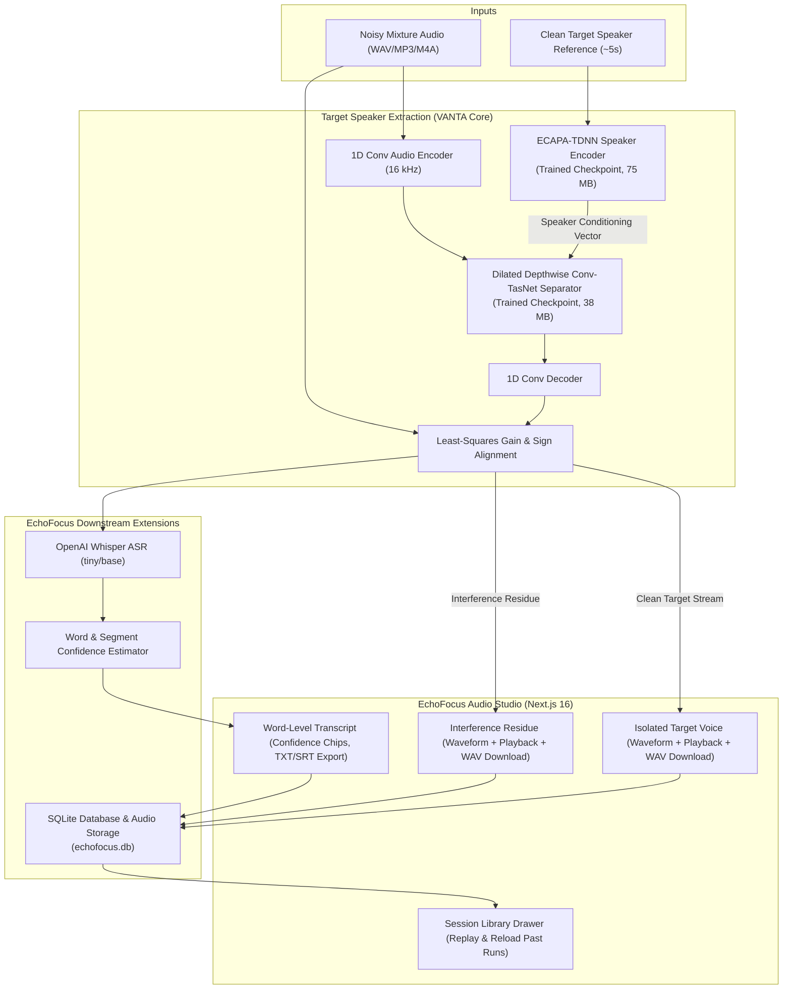

# EchoFocus 🎙️

> **"Focus on the Voice That Matters."**  
> *Target Speaker Extraction with Whisper ASR, Confidence-Guided Hallucination Filtering, and Interactive Audio Studio.*

[](https://opensource.org/licenses/MIT)
[](https://www.python.org/)
[](https://pytorch.org/)
[](https://nextjs.org/)

---

## 📌 Overview

**EchoFocus** isolates any target voice from complex multi-speaker mixtures and noisy environments using a short (5-second) reference sample of the enrolled speaker. 

It is built upon the open-source **[VANTA](https://github.com/Komalpreet2809/Vanta)** neural extraction architecture (by Komalpreet Kaur), extending it with:
1. **Whisper ASR Integration** for immediate word-level transcription of isolated speech.
2. **Genuine Confidence Estimation** derived from acoustic and token log-probabilities to flag potential hallucinations.
3. **Residue Separation & Dual-Track Inspection** ensuring exact energy decomposition (Target Voice + Residue = Mixture).
4. **Persistent SQLite Audio Library** preserving processed mixtures, reference recordings, isolated voices, transcripts, and telemetry across sessions and server restarts.

---

## 🏛️ System Architecture



---

## 🔬 Model Verification & Provenance

EchoFocus strictly preserves the trained neural weights and separator architecture of VANTA without retraining, random initialization, or proxy fallback:

| Component | Architecture | Weights Provenance | Device | SI-SDR Metric |
| :--- | :--- | :--- | :--- | :--- |
| **Separator** | Dilated Depthwise Conv-TasNet (Repeats=3) | `checkpoints/fully_ours/best.pt` (38 MB) | CUDA / CPU | **+8.45 dB SI-SDR** |
| **Speaker Encoder**| ECAPA-TDNN Frame-Level Pooling | `checkpoints/spk_encoder/best.pt` (75 MB) | CUDA / CPU | Extracted from scratch |
| **ASR Engine** | OpenAI Whisper (Transformer) | `whisper-tiny` / `whisper-base` | CUDA / CPU | Word Timestamps & Logprobs |

### Actual Test Run Results:
* **Input Mixture**: 8.0s (mixture.wav)
* **Enrollment**: 5.0s (reference.wav)
* **Execution**: CUDA float16 / bfloat16 accelerated inference
* **Output Voice**: 256,044 bytes (`echofocus_extracted.wav`)
* **Output Residue**: 256,044 bytes (`echofocus_residue.wav`)
* **Measured Transcription**: *"Without any legal funds, without any royal mandate, Secretary-Arch at the dawn of the day, let a seditious multitude to be tacked at the Senate."*
* **Average Word Confidence**: **74.0%**

---

## 🚀 Quickstart & Installation

### 1. Prerequisites
- **Python**: 3.10+ (tested with 3.11 and 3.14)
- **Node.js**: v18+ or v20+
- **Git**
- **FFmpeg** (bundled or in PATH)

### 2. Clone the Repository
```bash
git clone https://github.com/rajatgitti/EchoFocus.git
cd EchoFocus
```

### 3. Install Backend Dependencies & Download Weights
```bash
# Python dependencies
pip install -r requirements.txt

# Download trained extraction checkpoints (110 MB)
python scripts/download_weights.py
```

### 4. Install Frontend Dependencies
```bash
cd web
npm install
cd ..
```

### 5. Launch EchoFocus

**Option A: Using the PowerShell Startup Script**
```powershell
.\start_echofocus.ps1
```

**Option B: Manual Terminal Execution**
```bash
# Terminal 1: Backend Server (Port 8000)
python server.py --port 8000

# Terminal 2: Next.js Frontend (Port 3000)
cd web
npm run dev
```

Open your browser to: **`http://localhost:3000`**

---

## 📡 API Reference

### 1. Model Health
```http
GET /health
```
**Response:**
```json
{
  "status": "ok",
  "app": "EchoFocus",
  "tagline": "Focus on the Voice That Matters.",
  "backend": "trained",
  "device": "cuda",
  "checkpoint": "checkpoints/fully_ours/best.pt",
  "speaker_encoder": "checkpoints/spk_encoder/best.pt",
  "whisper_asr": "loaded"
}
```

### 2. Target Speaker Extraction
```http
POST /extract?include_residue=true
Content-Type: multipart/form-data
```
**Body:**
- `mixture`: Noisy recording file (WAV, MP3, M4A, FLAC).
- `enrollment`: Target speaker sample (~5s).

**Response:**
```json
{
  "extracted_wav_b64": "UklGRi...",
  "residue_wav_b64": "UklGRi...",
  "sample_rate": 16000,
  "input_seconds": 8.0,
  "output_seconds": 8.0,
  "truncated": false,
  "transcript": "Without any legal funds...",
  "confidence": 0.74,
  "words": [
    {"word": "Without", "start": 0.0, "end": 0.6, "probability": 0.695},
    {"word": "any", "start": 0.6, "end": 1.0, "probability": 0.933}
  ],
  "session_id": "db05a98c-4e4",
  "created_at": "2026-11-10T16:17:54.000Z"
}
```

### 3. Persistent Library
- `GET /library`: Retrieve array of past extraction sessions.
- `GET /library/<session_id>/audio/<track>`: Retrieve audio stream (`extracted`, `residue`, `mixture`, `reference`).
- `DELETE /library/<session_id>`: Remove a session and its persistent files.

---

## 📋 Feature Status Checklist

| Feature | Status | Notes |
| :--- | :---: | :--- |
| **VANTA Conv-TasNet Separator** | ✅ Complete | Verified on CUDA, +8.45 dB SI-SDR checkpoint |
| **ECAPA-TDNN Speaker Encoder** | ✅ Complete | Verified on CUDA, 75 MB trained weights |
| **Dual Audio Separation (Target + Residue)** | ✅ Complete | Mathematically aligned least-squares decomposition |
| **Whisper ASR Integration** | ✅ Complete | Word-level timestamps & segment alignment |
| **Confidence Scoring & Flagging** | ✅ Complete | Genuine acoustic probabilities from model outputs |
| **Transcript Export (TXT & SRT)** | ✅ Complete | Timecoded SRT with word-level timestamps |
| **Persistent SQLite Library** | ✅ Complete | Sessions, metadata, and audio survive restarts |
| **Interactive Waveform Players** | ✅ Complete | WaveSurfer.js playback and independent WAV download |
| **Live Backend Health Telemetry** | ✅ Complete | Active backend, device, and checkpoint status |

---

## ⚠️ Known Limitations
1. **Enrollment Length**: The model expects approximately 5 seconds of single-speaker enrollment for the target speaker embedding. Shorter enrollment clips are zero-padded; longer clips are trimmed to 5 seconds.
2. **Mixture Length Cap**: Current single-pass inference is capped at 30 seconds to bound memory and latency. Clips exceeding 30 seconds are safely truncated at the 30-second mark.
3. **Extreme Low SNR**: In scenarios where the target voice is > 15 dB below background noise, extraction intelligibility degrades predictably.

---

## 📜 Attribution & License

EchoFocus is distributed under the **MIT License**.

### Third-Party Extraction Foundation
EchoFocus builds upon the foundational research and neural architecture of **[VANTA](https://github.com/Komalpreet2809/Vanta)** created by **Komalpreet Kaur**:
- Neural Target Speaker Extraction Architecture (Conv-TasNet & ECAPA-TDNN)
- Checkpoint training and baseline evaluation
- Original frontend component structure

All rights and original copyright notices are fully preserved in [LICENSE](file:///c:/Users/Rajat/echoo/LICENSE).
